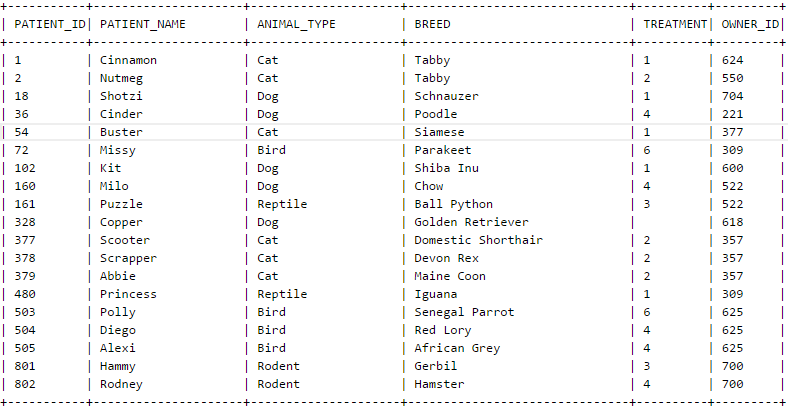

# AcuXDBC Linux Client Setup

### Prerequisites

Install unixODBC:  

RHEL  
```
sudo dnf install unixODBC-devel
```

SLES
```
sudo zypper install unixODBC-devel
```

Ubuntu
```
sudo apt install unixodbc-dev 
```

1. Execute the command `odbcinst -j` to find out where your SYSTEM and USER data sources are located:

    ```
    unixODBC 2.3.11
    DRIVERS............: /etc/odbcinst.ini
    SYSTEM DATA SOURCES: /etc/odbc.ini
    FILE DATA SOURCES..: /etc/ODBCDataSources
    USER DATA SOURCES..: /home/support/.odbc.ini
    SQLULEN Size.......: 8
    SQLLEN Size........: 8
    SQLSETPOSIROW Size.: 8                     
    ```

2. Add the following to the file where your SYSTEM data sources are located: example /etc/odbc.ini:

    ```
    [acuxdbc]
    Driver = /home/products/acu1100shx64/bin/acuxdbc.so
    DataSource = acuxdbc.cfg
    Description = AcuXDBC
    Host = localhost
    PortNumber = 20222
    UserID = system
    Password = manager
    FetchBufferSize = 8192
    MaxColumns = 256
    MaxDBCursors = 1024
    MaxStatements = 64
    MemorySortPages = 1000
    MergeBufferSize = 10000
    TotalSortPages = 10000
    # (Genesis - 0, VortexNet - 1)
    VortexDriver = 1
    ```

    > Note: If your client and server are the same machine, set `VortexDriver` to `0`, otherwise set it to `1`.

3. Set two operating environment variables called VORTEX_HOME and GENESIS_HOME. These environment variables should be set to the root installation directory of AcuXDBC:

    ```
    export VORTEX_HOME=/home/products/acu1100shx64
    export GENESIS_HOME=/home/products/acu1100shx64
    ```

    > Note: the value assigned to the environment variable should not have a '/' as the last character as this can interfere with the installation and configuration scripts.  

4. Environment variables need to be set or modified that point to the location of the AcuXDBC executables and to tell the operating system where to find the AcuXDBC shared libraries:

    ```
    export PATH=/home/products/acu1100shx64/bin:$PATH
    export LD_LIBRARY_PATH=/home/products/acu1100shx64/bin:/home/products/acu1100shx64/lib:$LD_LIBRARY_PATH
    ```

5. Verify the connection using `isql`, the interactive SQL command-line utility included with unixODBC:  

    ```
    $ isql -v acuxdbc system manager

    +---------------------------------------+  

      Connected!

      sql-statement  
      help [tablename]   
      quit    

    +---------------------------------------+  
    ```

6. Connect to a Vision file called 'pets', that is physically located at $GENESIS_HOME/sample/acuxdbc/data, and whose XFD was loaded by the demo.sh script.  

    ```
    SQL> select * from pets
    ```

    